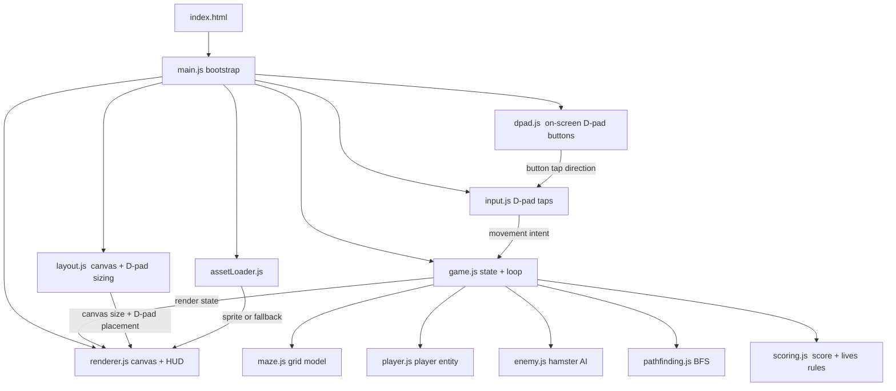
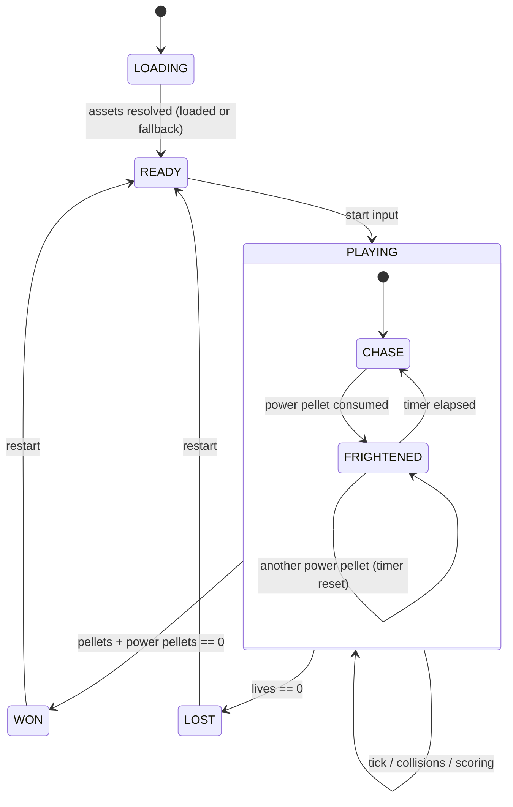
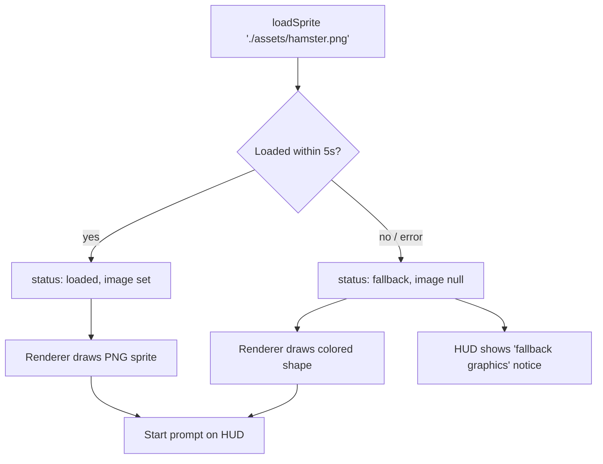

# Design Document: PacHuat

## Overview

PacHuat is a browser-based maze arcade game inspired by Pac-Man, built entirely as a static web application using HTML, CSS, vanilla JavaScript, and the HTML5 Canvas 2D API. There is no backend, no server-side runtime, and no request-time build step, which makes it deployable directly to GitHub Pages and shareable via a public link.

PacHuat is mobile-only and touch-only: the target is a phone browser in portrait orientation, controlled solely by an on-screen D-pad (four tappable directional buttons) rendered as part of the game interface. There is no keyboard support. The layout arranges the canvas and the D-pad to fit within the viewport without scrolling in portrait and reflows on orientation change.

The player navigates a grid-based maze, consuming pellets and power pellets while being pursued by four hamster enemies. Each enemy is drawn using a background-removed hamster sprite derived from the supplied photo. Consuming a power pellet places the game into a time-limited Frightened state during which the player can consume enemies for bonus points. The game tracks score and lives and resolves to a win (all pellets cleared) or loss (lives exhausted) condition.

### Key Design Decisions

| Decision | Rationale |
| --- | --- |
| Vanilla JavaScript, no framework | Keeps the static bundle tiny and dependency-free, so GitHub Pages serves it with zero build tooling. A framework would add complexity without benefit for a single-canvas game. |
| ES modules loaded directly | Modern browsers support `<script type="module">` natively, allowing clean file separation (one module per concern) without a bundler. |
| Fixed-timestep game loop with `requestAnimationFrame` | Decouples simulation from frame rate, guaranteeing deterministic movement (constant tiles/second) and satisfying the >=30 FPS requirement across devices. |
| Tile-based grid model with pixel interpolation | Pac-Man-style gameplay is naturally grid-aligned; entities snap decisions to tile centers but render at interpolated pixel positions for smooth motion. |
| BFS for enemy pathfinding | The maze is small and static; breadth-first search gives exact shortest-path distances per adjacent tile, satisfying the "shortest path distance" selection rule precisely. |
| Pre-processed PNG sprite committed to repo | Background removal is done once at authoring time (not in the browser), keeping runtime simple and avoiding image-processing dependencies. A relative path and colored-shape fallback keep the game robust on GitHub Pages. |
| On-screen D-pad as the sole control (not swipe gestures) | Four discrete tappable buttons give precise, unambiguous directional input on touch screens. Swipe gestures are error-prone in a grid maze — direction and threshold are ambiguous, and swipes conflict with the browser's scroll/zoom gestures. Discrete buttons map 1:1 to a direction and are trivial to make reliable and accessible. The D-pad is the only input mechanism; there is no keyboard. |
| Mobile-first responsive layout | The canvas and D-pad are laid out for a portrait phone first, then adapted upward. CSS and a resize/orientation handler scale the canvas to the viewport width and position the D-pad so both fit without scrolling, keeping touch targets large enough to tap comfortably (Req 10). |

### Research Notes

- **GitHub Pages path behavior**: Project sites are served from `https://{user}.github.io/{repo}/`, so all asset references must be relative (e.g., `./assets/hamster.png`), never root-absolute (`/assets/...`), which would resolve to the user domain root and 404. This directly drives Requirements 9.2 and 9.6. ([GitHub Pages docs](https://docs.github.com/en/pages))
- **Canvas 2D `drawImage` with transparency**: PNG alpha channels are respected by `CanvasRenderingContext2D.drawImage`, so a background-removed PNG renders with a transparent background with no extra code. ([MDN drawImage](https://developer.mozilla.org/en-US/docs/Web/API/CanvasRenderingContext2D/drawImage))
- **Background removal tooling**: A one-time authoring step (e.g., an online remover like remove.bg, or GIMP/Photoshop) produces a cropped transparent PNG from the source JPEG. This is committed to the repo; no runtime processing is needed. Content was rephrased for compliance with licensing restrictions.
- **Fixed-timestep loops**: Accumulator-based fixed updates with `requestAnimationFrame` are the standard approach to make physics/movement frame-rate independent. ([Game loop pattern](https://gameprogrammingpatterns.com/game-loop.html))

## Architecture

The game is organized into focused ES modules loaded by a single `index.html`. The architecture separates the simulation (pure game state + rules) from the I/O layers (input and rendering), which keeps the testable logic independent of the DOM and Canvas.



### Layered Responsibilities

1. **Bootstrap layer** (`main.js`): Obtains the canvas context, kicks off asset loading, constructs the game, wires input and the D-pad, performs the initial layout, and starts the loop. Handles the context-acquisition failure case (Req 7.7).
2. **Simulation layer** (`game.js`, `maze.js`, `player.js`, `enemy.js`, `pathfinding.js`, `scoring.js`): Pure, DOM-free logic. Advances state by a fixed timestep given the current movement intent. This is the layer property-based tests target.
3. **I/O layer** (`input.js`, `dpad.js`, `layout.js`, `renderer.js`, `assetLoader.js`): Translates D-pad taps into movement intents, manages the on-screen D-pad, sizes/positions the canvas and D-pad for the viewport, draws state to the canvas, and loads/falls back on assets. Side-effect heavy; tested with example and mock-based tests.

### Input Source

The `InputHandler` derives a single current movement intent from one source — the on-screen D-pad:

- **On-screen D-pad** (touch, the only control): four tappable directional buttons rendered in the DOM and overlaid on/below the canvas. A tap on a button sets the intent to that button's direction (Req 8.1). The D-pad is managed by `dpad.js` (small DOM/touch concern) and forwards taps into `input.js`; it is displayed persistently while a session is active (Req 8.2) and calls `preventDefault` on its touch events to block scroll/zoom/selection (Req 8.3). When multiple taps arrive within a single frame, the most-recent tap wins (Req 1.6, 8.4).

There are no swipe gestures and no keyboard; directional input comes exclusively from the discrete D-pad buttons.

### Mobile-First Layout

`layout.js` owns the responsive arrangement of the canvas and the D-pad (Req 10):

- On load and on `resize`/`orientationchange`, it scales the canvas so its rendered width is at most the viewport width while preserving the maze aspect ratio (Req 7.6), and positions the D-pad below the canvas so both fit within the viewport without the page scrolling in portrait (Req 10.1).
- Each D-pad button is sized to at least 44x44 CSS pixels (Req 10.2) via CSS.
- `index.html` declares a viewport meta that scales to device width at initial scale 1.0 and disables user zoom (Req 10.3, 10.4).
- Orientation changes trigger a reflow that repositions and rescales the canvas and D-pad within 500 ms (Req 10.5).

### Game Loop

A fixed-timestep loop drives the simulation. `requestAnimationFrame` supplies wall-clock deltas; an accumulator runs zero or more fixed simulation steps (default 60 Hz), then a single render per frame. This guarantees constant tile speeds (Req 1.3) and a render rate that meets or exceeds 30 FPS (Req 7.1).

```mermaid
sequenceDiagram
    participant RAF as requestAnimationFrame
    participant Loop as Game Loop
    participant Sim as Simulation (game.js)
    participant Rend as Renderer

    RAF->>Loop: timestamp
    Loop->>Loop: accumulator += delta
    loop while accumulator >= STEP
        Loop->>Sim: update(STEP, movementIntent)
        Loop->>Loop: accumulator -= STEP
    end
    Loop->>Rend: render(gameState, interpolation)
    Loop->>RAF: schedule next frame
```

### State Machine

The game is governed by a top-level mode plus an orthogonal Frightened sub-state active only within `PLAYING`.



## Components and Interfaces

### `assetLoader.js`

Loads the hamster sprite via a relative path with a timeout and fallback (Req 9.2, 9.3, 9.4).

```javascript
// loadSprite(relativePath, timeoutMs) -> Promise<{ status: 'loaded'|'fallback', image: HTMLImageElement|null }>
//   Resolves 'loaded' with the Image on success.
//   Resolves 'fallback' (never rejects) on error or timeout (default 5000 ms).
export function loadSprite(relativePath, timeoutMs = 5000) { /* ... */ }
```

### `input.js` (`InputHandler`)

Translates D-pad button taps into a single current movement intent (Req 1.2, 1.6, 8.1, 8.4).

```javascript
export class InputHandler {
  constructor({ dpad = null } = {}) {}
  // Current requested direction: 'up'|'down'|'left'|'right'|null
  get intent() {}
  // Most recent tap wins when multiple taps arrive in one frame (Req 1.6, 8.4)
  // D-pad: setFromDpad(direction) is invoked by dpad.js on a button tap,
  //   setting the intent to that button's direction (Req 1.2, 8.1)
  setFromDpad(direction) {}
  attach() {}   // wires the D-pad (the sole input source)
  detach() {}
}
```

### `dpad.js` (`DPad`)

Owns the persistent on-screen directional buttons for touch devices (Req 8.1, 8.2, 8.3). It is a thin DOM/touch concern that forwards taps to the `InputHandler`.

```javascript
export class DPad {
  // buttonsRoot: the DOM element containing the four direction buttons
  constructor(buttonsRoot, { onDirection } = {}) {}
  // Wires touchstart/click on each of the up/down/left/right buttons.
  // On tap: calls preventDefault (block scroll/zoom/selection, Req 8.3)
  //   then invokes onDirection(direction) within 50 ms (Req 8.1).
  attach() {}
  detach() {}
  // Shown persistently while a session is active (Req 8.2); CSS keeps each
  // button touch target >= 44x44 CSS px (Req 10.2).
}
```

### `layout.js` (`Layout`)

Owns the mobile-first responsive arrangement of the canvas and D-pad (Req 7.6, 10.1, 10.5).

```javascript
export class Layout {
  constructor(canvas, dpadRoot, maze) {}
  // Scales the canvas so rendered width <= viewport width while
  // preserving the maze aspect ratio (Req 7.6), and positions the
  // D-pad so canvas + D-pad fit within the viewport without the page
  // scrolling in portrait (Req 10.1).
  apply(viewportWidth, viewportHeight) {}
  // Debounced resize/orientationchange handler; completes reflow
  // within ORIENTATION_REFLOW_MS (500 ms) of an orientation change (Req 10.5).
  attach() {}
  detach() {}
}
```

### `maze.js` (`Maze`)

Immutable-structure grid plus mutable pellet state.

```javascript
export class Maze {
  constructor(layout) {} // layout: array of strings
  get width() {} get height() {}
  isWall(col, row) {}
  isTunnelExit(col, row) {}        // horizontal wrap edges (Req 1.5)
  tunnelPartner(col, row) {}       // opposite edge coordinate
  hasPellet(col, row) {}
  hasPowerPellet(col, row) {}
  removePellet(col, row) {}        // returns points removed or 0 (Req 2.1, 2.7)
  removePowerPellet(col, row) {}   // returns points removed or 0 (Req 2.2, 2.7)
  remainingCollectibles() {}       // pellets + power pellets count (Req 6.1)
  openNeighbors(col, row) {}       // walkable adjacent tiles
  reset() {}                       // restore full pellet set (Req 6.4)
}
```

### `pathfinding.js`

```javascript
// bfsDistances(maze, targetCol, targetRow) -> Map<tileKey, number>
//   Shortest path distance (in tiles) from every reachable tile to the target.
export function bfsDistances(maze, targetCol, targetRow) {}

// chooseDirection(maze, fromTile, distances, currentDir) -> 'up'|'left'|'down'|'right'
//   Picks the open neighbor with the smallest distance; ties broken in
//   fixed order up, left, down, right (Req 3.3, 3.4). Avoids reversing unless
//   it is the only option (Req 3.7, 3.8).
export function chooseDirection(maze, fromTile, distances, currentDir) {}
```

### `player.js` (`Player`)

```javascript
export class Player {
  constructor(spawn) {}
  tile; dir; requestedDir; bufferedDir; bufferAgeMs;
  // Advances toward requestedDir if open; else stays and keeps prior dir (Req 1.3, 1.4)
  // Applies buffered direction at next tile where it is open; expires after 1s (Req 1.7)
  // Wraps through tunnels preserving dir and speed (Req 1.5)
  update(stepMs, maze, intent) {}
  resetTo(spawn) {}
}
```

### `enemy.js` (`HamsterEnemy`)

```javascript
export class HamsterEnemy {
  constructor(spawn, speedTilesPerSec) {} // speed in [4,8], constant for game (Req 3.2)
  tile; dir; mode; // 'chase' | 'frightened' | 'returning'
  update(stepMs, maze, playerTile, frightened) {} // pursuit via BFS (Req 3.2-3.4,3.7,3.8)
  sendToSpawn() {}  // consumed in frightened: relocate to spawn (Req 4.4, 4.8)
  resetTo(spawn) {}
}
```

### `scoring.js`

```javascript
export const POINTS = { PELLET: 10, POWER_PELLET: 50, ENEMY: 200 };
// clampScore(n) -> integer in [0, 9_999_999] (Req 2.5, 2.6)
export function clampScore(n) {}
```

### `game.js` (`Game`)

The simulation hub. Holds all state and exposes a pure-ish `update` plus query getters the renderer reads.

```javascript
export class Game {
  constructor(mazeLayout, config) {}
  // Modes: 'loading'|'ready'|'playing'|'won'|'lost'
  get mode() {} get score() {} get lives() {} get frightened() {}
  get frightenedRemainingMs() {}
  start() {}                 // ready -> playing (Req 9.5)
  update(stepMs, intent) {}  // advance one fixed step
  restart() {}               // reset to a fresh session (Req 6.4)
  // Internals: pellet consumption, power pellet -> frightened (8s, resettable),
  // collision detection + invulnerability window, lives, win/loss transitions.
}
```

### `renderer.js` (`Renderer`)

```javascript
export class Renderer {
  constructor(ctx, sprite /* HTMLImageElement|null */) {}
  render(game)            // draw maze, pellets, player, enemies, HUD (Req 7.*)
  // Enemies drawn with sprite at tile position; frightened appearance differs;
  // blink in last 2s; colored-shape fallback when sprite is null (Req 3.5,3.6,4.2,4.3,9.3)
  // Canvas pixel sizing and D-pad placement are owned by layout.js (Req 7.6, 10.*).
}
```

## Data Models

### Tile and Direction

```javascript
// A tile is a grid cell addressed by integer column/row.
Tile = { col: number, row: number }

// Direction is one of these string constants (null = no movement).
Direction = 'up' | 'down' | 'left' | 'right' | null

// Direction vectors used for movement and neighbor lookup.
VECTORS = {
  up:    { dcol: 0,  drow: -1 },
  down:  { dcol: 0,  drow:  1 },
  left:  { dcol: -1, drow:  0 },
  right: { dcol: 1,  drow:  0 },
}

// Fixed tie-break priority for enemy direction selection (Req 3.4).
TIE_BREAK_ORDER = ['up', 'left', 'down', 'right']
```

### Maze Layout

The maze is authored as an array of equal-length strings, one character per tile. This is human-editable and trivially serializable.

```
# = wall        (space) = empty path
. = pellet      o = power pellet
P = player spawn
H = hamster spawn
T = tunnel edge marker (horizontal wrap)
```

```javascript
MazeCell = {
  wall: boolean,
  pellet: boolean,
  powerPellet: boolean,
  tunnel: boolean,
}
```

### Entity State

```javascript
PlayerState = {
  spawn: Tile,
  tile: Tile,              // current logical tile
  pixel: { x, y },         // interpolated render position
  dir: Direction,          // current movement direction
  requestedDir: Direction, // from input intent
  bufferedDir: Direction,  // pending turn (Req 1.7)
  bufferAgeMs: number,     // 0..1000, expires buffered dir
}

EnemyState = {
  spawn: Tile,
  tile: Tile,
  pixel: { x, y },
  dir: Direction,
  speedTilesPerSec: number, // in [4,8], constant per game (Req 3.2)
  mode: 'chase' | 'frightened' | 'returning',
}
```

### Game State

```javascript
GameState = {
  mode: 'loading' | 'ready' | 'playing' | 'won' | 'lost',
  score: number,              // clamped [0, 9_999_999]
  lives: number,              // 0..3
  maze: Maze,
  player: PlayerState,
  enemies: EnemyState[],      // length 4 (Req 3.1)
  frightened: {
    active: boolean,
    remainingMs: number,      // 0..8000 (Req 4.1, 4.7)
  },
  invulnerableMs: number,     // collision debounce window (Req 5.3)
}
```

### Configuration Constants

```javascript
CONFIG = {
  SIM_HZ: 60,                 // fixed timestep rate
  PLAYER_SPEED_TPS: 6,        // tiles/sec (Req 1.3)
  ENEMY_SPEED_TPS: 6,         // tiles/sec, in [4,8] (Req 3.2)
  FRIGHTENED_MS: 8000,        // (Req 4.1)
  FRIGHTENED_BLINK_MS: 2000,  // blink window (Req 4.3)
  BLINK_TOGGLES_PER_SEC: 4,   // (Req 4.3)
  START_LIVES: 3,             // (Req 5.1)
  COLLISION_DEBOUNCE_MS: 1500,// (Req 5.3)
  BUFFER_EXPIRE_MS: 1000,     // (Req 1.7)
  SPRITE_TIMEOUT_MS: 5000,    // (Req 9.3)
  DPAD_MIN_TOUCH_PX: 44,      // min D-pad touch target size (Req 10.2)
  ORIENTATION_REFLOW_MS: 500, // max reflow time on orientation change (Req 10.5)
  RESPONSIVE_MAX_WIDTH_PX: 600, // responsive scaling breakpoint (Req 7.6, 10.1)
  POINTS: { PELLET: 10, POWER_PELLET: 50, ENEMY: 200 },
  SCORE_MAX: 9_999_999,
}
```

## Asset Pipeline (Hamster Sprite)

The hamster enemy sprite is produced once at authoring time and committed to the repository, so there is no runtime image processing and no build step at request time (Req 9.1).

### Production Steps (one-time, authoring)

1. Start from the source photo at the workspace root: `WhatsApp Image 2026-10-02 at 7.56.12 PM.jpeg`.
2. Crop to the hamster and remove the background (including the cardboard box) using an image editor or an online background remover, producing a transparent-background result (Req 3.6).
3. Export as `assets/hamster.png` (PNG preserves the alpha channel). Keep it reasonably small (e.g., <= 128x128) for fast loading.
4. Commit `assets/hamster.png` to the repository alongside the game source.

### Runtime Loading and Fallback



- The path is relative (`./assets/hamster.png`), never root-absolute, so it resolves correctly under a GitHub Pages project subpath (Req 9.2, 9.6).
- On error or a 5-second timeout, the loader resolves (never rejects) in `fallback` mode; the renderer draws a distinct colored shape and the HUD shows a fallback notice, with gameplay fully preserved (Req 9.3, 9.4).
- Once assets resolve (loaded or fallback), the HUD shows a start prompt and gameplay waits for a start input (Req 9.5).

## GitHub Pages Deployment

- **Structure**: Flat static site at the repo root — `index.html`, `styles.css`, `src/*.js` (ES modules), `assets/hamster.png`. No bundler, transpiler, or server runtime (Req 9.1).
- **Relative references**: `index.html` references scripts and styles with relative paths; `assetLoader` uses `./assets/hamster.png`. This guarantees correct resolution at `https://{user}.github.io/{repo}/` (Req 9.2, 9.6).
- **Viewport meta**: `index.html` declares `<meta name="viewport" content="width=device-width, initial-scale=1.0, user-scalable=no">` so the game scales to the device width at initial scale 1.0 and pinch/double-tap zoom cannot disrupt gameplay (Req 10.3, 10.4).
- **D-pad markup/CSS**: The on-screen D-pad is part of the static markup in `index.html` and styled in `styles.css` (buttons sized to at least 44x44 CSS px, Req 10.2). It ships with the static site and requires no runtime build (Req 9.1).
- **Publishing**: Enable GitHub Pages on the repository (serve from the default branch root or `/docs`). No workflow build is required since the files are already static; an optional trivial Pages action can deploy as-is.
- **Verification**: After deploy, load the project URL and confirm the sprite loads over the relative path and no absolute `/`-rooted request 404s.

## Correctness Properties

*A property is a characteristic or behavior that should hold true across all valid executions of a system — essentially, a formal statement about what the system should do. Properties serve as the bridge between human-readable specifications and machine-verifiable correctness guarantees.*

These properties target the pure simulation layer (`game.js`, `maze.js`, `player.js`, `enemy.js`, `pathfinding.js`, `scoring.js`, the D-pad intent-mapping logic in `input.js`, and the pure layout-fit computation in `layout.js`), which is DOM-free and exercises a large input space. Rendering, HUD, viewport meta, orientation-reflow timing, deployment, and asset-authoring criteria are validated with example, integration, and smoke tests instead (see Testing Strategy).

### Property 1: Movement along open paths is constant-speed

*For all* open corridors and any number of fixed simulation steps during which the requested direction stays open, the player's cumulative displacement equals `PLAYER_SPEED_TPS * elapsedSeconds` (within one-tile tolerance) and the movement direction is preserved.

**Validates: Requirements 1.3**

### Property 2: A wall blocks movement and preserves prior direction

*For all* player tiles and maze configurations where the requested direction points at a wall, after an update the player's tile is unchanged and the player's prior movement direction is retained.

**Validates: Requirements 1.4**

### Property 3: Tunnel wrap preserves direction and speed

*For all* tunnel exit edges, moving the player (or an enemy) across the exit repositions it at the partner edge tile while preserving its current movement direction and speed.

**Validates: Requirements 1.5**

### Property 4: Most recent direction tap wins within a frame

*For all* non-empty sequences of D-pad direction taps received within a single frame, the resulting requested movement direction equals the direction of the final tap.

**Validates: Requirements 1.6, 8.4**

### Property 5: Buffered turns apply at the first open tile and expire after one second

*For all* buffered directions, the buffered direction is applied as the player's movement direction at the first subsequently reached tile where that direction is open within 1000 ms, and is discarded if no such tile is reached within 1000 ms.

**Validates: Requirements 1.7**

### Property 6: Consuming a collectible removes it and adds its exact point value

*For all* mazes and tiles containing an uneaten collectible, when the player occupies that tile the collectible is removed, the remaining-collectible count decreases by one, and the score increases by exactly 10 for a pellet or 50 for a power pellet.

**Validates: Requirements 2.1, 2.2**

### Property 7: Consuming an already-empty tile is idempotent on score

*For all* tiles whose pellet or power pellet has already been removed, occupying that tile again leaves the score and remaining-collectible count unchanged.

**Validates: Requirements 2.7**

### Property 8: Score stays within bounds

*For all* arbitrary sequences of scoring events, the resulting score is clamped to the inclusive range 0 to 9,999,999.

**Validates: Requirements 2.5, 2.6**

### Property 9: Frightened consumption scores 200 per enemy

*For all* sets of enemies overlapping the player's tile during Frightened state, the score increases by exactly 200 multiplied by the number of enemies consumed.

**Validates: Requirements 2.3, 4.5**

### Property 10: Enemy direction selection minimizes distance with fixed tie-break and no needless reversal

*For all* mazes and enemy/player positions, the direction chosen for a pursuing enemy leads to an open (non-wall) tile whose shortest-path distance to the player is the minimum among the enemy's candidate open neighbors; ties are resolved in the fixed order up, left, down, right; and the enemy reverses its current direction only when reversal is the sole open option.

**Validates: Requirements 3.2, 3.3, 3.4, 3.7, 3.8**

### Property 11: Collision is registered exactly when overlapping outside Frightened state

*For all* game states, a collision event between the player and an enemy is registered if and only if the player and that enemy occupy the same tile and the game is not in Frightened state.

**Validates: Requirements 3.9**

### Property 12: A power pellet activates Frightened state for the full duration

*For all* game states, consuming a power pellet sets Frightened state active with its remaining duration equal to `FRIGHTENED_MS` (8000 ms), regardless of the state prior to consumption.

**Validates: Requirements 4.1, 4.7**

### Property 13: Overlap during Frightened state sends the enemy to spawn

*For all* enemies overlapping the player's tile while in Frightened state, after the update that enemy is in the returning/at-spawn state rather than remaining at the overlap tile in pursuit.

**Validates: Requirements 4.4**

### Property 14: Frightened timeout returns non-relocating enemies to pursuit

*For all* game states at the moment the Frightened timer reaches zero, every enemy that is not currently relocating transitions to chase mode.

**Validates: Requirements 4.6**

### Property 15: A non-fatal collision decreases lives by exactly one, with debounce

*For all* collision events registered outside the 1500 ms debounce window, lives decrease by exactly one; and *for all* pairs of collisions separated by less than 1500 ms, the total decrease in lives is one, not two.

**Validates: Requirements 5.2, 5.3**

### Property 16: Surviving a collision returns all characters to spawn

*For all* collisions after which lives remain at one or greater, the player and every enemy are repositioned to their defined spawn tiles.

**Validates: Requirements 5.4**

### Property 17: Losing the last life ends the session

*For all* collisions that bring lives to zero, the game mode transitions to `lost`.

**Validates: Requirements 5.5**

### Property 18: Lives stay within range

*For all* sequences of collisions and resets, the lives count remains within the inclusive range 0 to 3.

**Validates: Requirements 5.7**

### Property 19: Clearing all collectibles wins the game

*For all* consumption sequences that reduce the combined count of remaining pellets and power pellets to zero, the game mode becomes `won`.

**Validates: Requirements 6.1**

### Property 20: Ended games reject movement input

*For all* movement intents applied while the game mode is `won` or `lost`, the player's tile and every enemy's tile are unchanged after the update.

**Validates: Requirements 5.6, 6.2**

### Property 21: Restart yields a fresh session

*For all* ended games (won or lost), performing a restart produces a state equal to a freshly started session: the maze has its full set of pellets and power pellets, the score is 0, lives is 3, and all characters are at their spawn tiles.

**Validates: Requirements 6.4**

### Property 22: Responsive canvas scaling preserves aspect ratio

*For all* viewport widths, the computed canvas render width is less than or equal to the viewport width when the viewport is below 600 pixels, and the rendered width-to-height ratio equals the maze's aspect ratio in all cases.

**Validates: Requirements 7.6**

### Property 23: D-pad taps set the intent to the tapped direction

*For all* D-pad button taps, the resulting movement intent equals the tapped button's direction (up, down, left, or right).

**Validates: Requirements 8.1**

### Property 24: Responsive layout fits the viewport in portrait with adequate touch targets

*For all* portrait viewport sizes with a width at or below `RESPONSIVE_MAX_WIDTH_PX` (600), the computed layout places the canvas and the D-pad within the viewport bounds without overflow (so the page does not need to scroll), and each D-pad button's computed touch target is at least `DPAD_MIN_TOUCH_PX` (44) CSS pixels on each side.

**Validates: Requirements 10.1, 10.2**

### Property 25: Sprite load failures resolve to a playable fallback

*For all* sprite load failures (load error or timeout at `SPRITE_TIMEOUT_MS`), `loadSprite` resolves (never rejects) with status `fallback` and a null image, allowing the game to proceed to a ready, playable state.

**Validates: Requirements 9.3**

## Error Handling

| Condition | Requirement | Handling |
| --- | --- | --- |
| Canvas 2D context unavailable | 7.7 | Bootstrap detects a null context, renders a plain-DOM error message, and never starts the loop or simulation. |
| Hamster sprite load error | 9.3, 9.4 | `loadSprite` catches the error event and resolves `fallback`; the renderer draws a distinct colored shape; the HUD shows a "fallback graphics in use" notice. |
| Hamster sprite load timeout (5 s) | 9.3 | A timer races the load; on expiry the loader resolves `fallback` and cancels the pending image. |
| Enemy trapped (only reverse open) | 3.8 | Pathfinding allows reversal when it is the sole open neighbor, preventing a stuck enemy. |
| Unreachable player (BFS no path) | 3.2, 3.3 | If the player tile is unreachable, the enemy keeps its current open direction or reverses per 3.7/3.8 rather than throwing. |
| Score overflow/underflow | 2.6 | Every score mutation passes through `clampScore`, bounding the value to [0, 9,999,999]. |
| Rapid repeated collisions | 5.3 | A 1500 ms invulnerability window suppresses duplicate life loss. |
| D-pad default gestures | 8.3 | D-pad taps call `preventDefault` to block scroll/zoom/text selection so controls do not disrupt gameplay. |
| Orientation / viewport change | 10.5 | A debounced resize/orientationchange handler reflows the canvas and D-pad within 500 ms; the layout always keeps both within the viewport in portrait. |

## Testing Strategy

### Dual Approach

- **Property-based tests** verify the 25 universal properties above against the pure simulation and layout-computation logic across many generated inputs. They catch general correctness bugs in movement, pathfinding, scoring, state transitions, timing, D-pad intent mapping, and responsive layout fit.
- **Unit (example) tests** verify specific scenarios, initialization, D-pad input mapping, and error paths.
- **Integration/mock tests** verify rendering, HUD updates, and the game-loop wiring using a mock Canvas 2D context.
- **Smoke/asset checks** verify static-hosting and sprite-asset constraints.

### Property-Based Testing

- **Library**: [fast-check](https://github.com/dubzzz/fast-check) for JavaScript. We will not implement property testing from scratch.
- **Runner**: Vitest (fast, ESM-native, no bundler config). Dev-only; it does not affect the static deployment.
- **Iterations**: each property test runs a minimum of 100 iterations (`{ numRuns: 100 }`).
- **Tagging**: each property test is tagged with a comment referencing its design property, in the format:
  `// Feature: pacman-hamster, Property {number}: {property_text}`
- **One test per property**: each of the 25 correctness properties is implemented by a single property-based test.
- **Generators**: custom arbitraries produce valid maze layouts (walls/paths/pellets/tunnels), reachable tile pairs, D-pad tap sequences, scoring-event sequences, D-pad direction taps, viewport sizes (portrait, including sub-600px widths), and collision timing sequences. Edge cases from the prework (dead ends for 3.8, returning-at-timeout for 4.8, non-HTML/empty-like degenerate mazes) are covered by generator design.

### Example / Unit Tests

- Initialization: player at spawn and expected pellet counts (1.1); 4 enemies at spawns (3.1); start sets lives to 3 (5.1).
- D-pad input: tapping each of the four D-pad buttons sets the movement intent to that direction (8.1); the D-pad is displayed as a persistent control while a session is active (8.2); a D-pad tap calls `preventDefault` to block scroll/zoom/text selection (8.3).
- Readiness: assets resolved → ready mode with start prompt, gameplay gated on start input (9.5); fallback HUD notice shown with gameplay preserved (9.4).

### Integration / Mock Tests

- Rendering with a mock ctx: `drawImage` per enemy at expected coordinates (3.5); frightened appearance differs from pursuit (4.2); blink toggles at 4/sec near end of frightened (4.3); win/loss HUD messages and final score (6.3, 7.4, 7.5); HUD reads current score/lives after changes (2.4, 7.2, 7.3).
- Loop: renders each frame and sustains the simulation step rate (7.1); canvas-context failure shows error and does not start (7.7).
- Mobile layout: in a simulated portrait viewport <= 600px, the canvas and D-pad fit without page scroll (10.1); each D-pad button's computed size is >= 44x44 CSS px (10.2); an `orientationchange`/`resize` event triggers a reflow that repositions and rescales the canvas and D-pad within 500 ms (10.5, 7.6).
- Viewport meta: `index.html` declares a viewport meta with `width=device-width`, `initial-scale=1.0`, and `user-scalable=no` (10.3, 10.4).

### Smoke / Asset Checks

- `assets/hamster.png` exists and is a transparent-background PNG (3.6).
- Repository contains only static assets, no server runtime or request-time build (9.1).
- Asset paths are relative (`./...`), never root-absolute, verified for both the sprite loader and `index.html` (9.2, 9.6).

### Why PBT Is Scoped to the Simulation Layer

The simulation logic (movement, BFS pursuit, pellet/scoring, frightened and win/loss timing, D-pad intent mapping) and the pure layout-fit computation are input-driven, so "for all inputs X, property P(X) holds" statements are meaningful and 100+ iterations surface edge cases that fixed examples miss. Rendering, HUD timing, DOM wiring of the D-pad, viewport meta, orientation-reflow timing, deployment, and asset authoring do not vary meaningfully with large input spaces, so they use example, integration/mock, and smoke tests instead.

